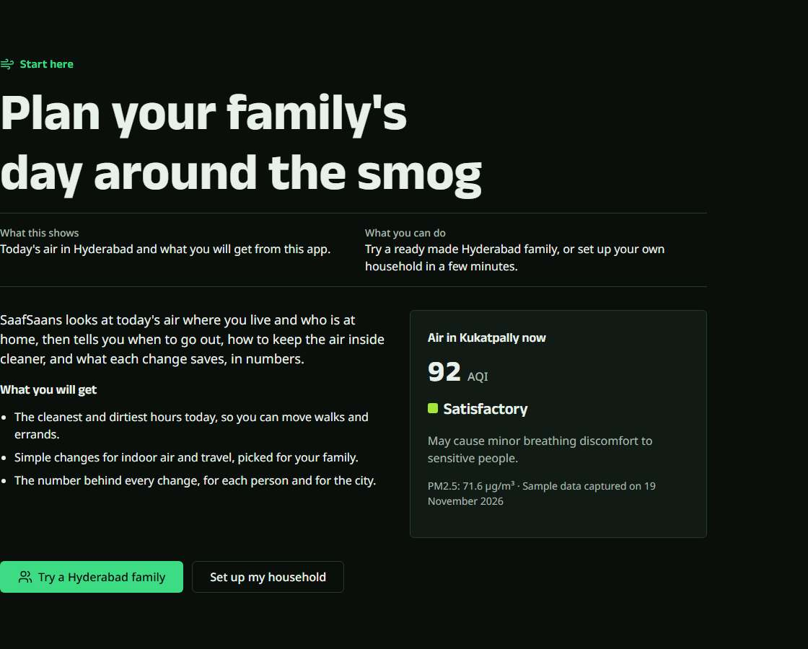
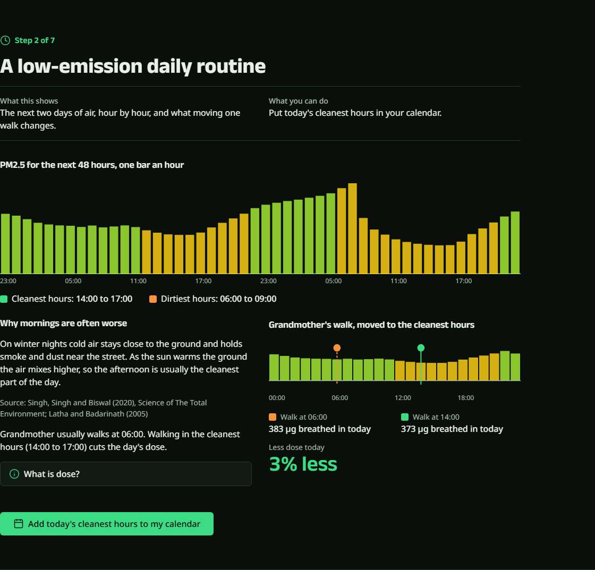
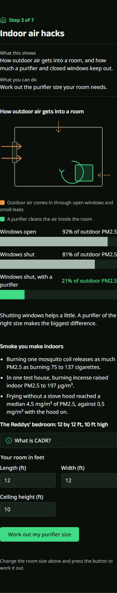
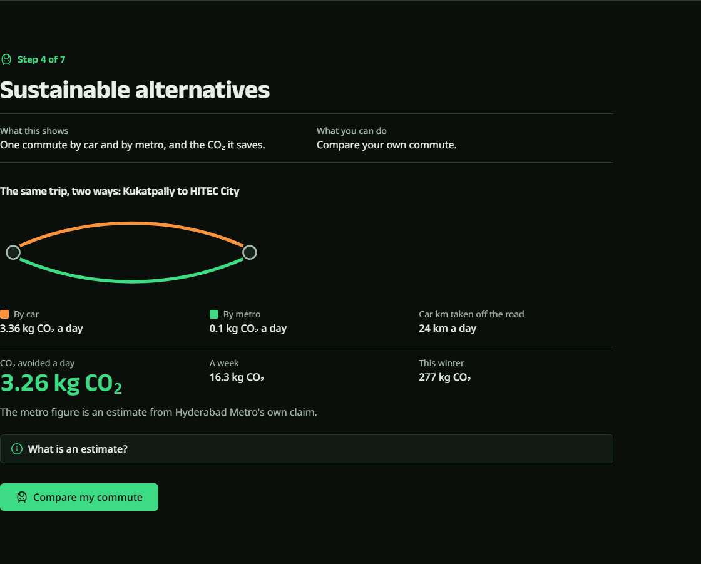
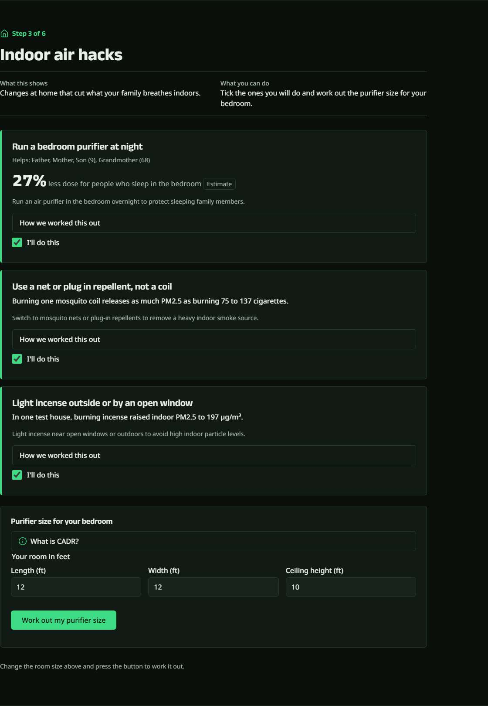
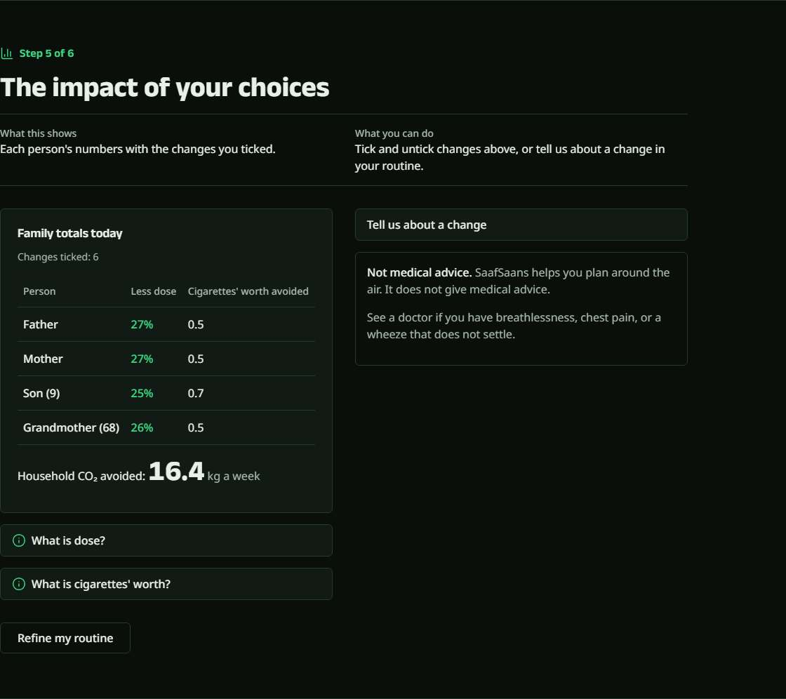
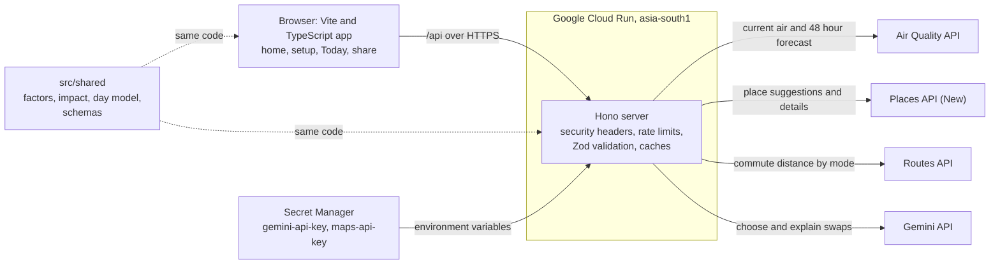

# SaafSaans: your family's smog plan

**Live:** https://saafsaans-382086946715.asia-south1.run.app

**Blog:** https://dev.to/aravind_nethi_44bcf041842/saafsaans-a-family-smog-plan-where-every-number-is-worked-out-not-guessed-kim

Open it and press **Try a Hyderabad family** to see a full plan in one click, or **Set up my household** to make your own. English, हिन्दी and తెలుగు are one tap away in the header.

SaafSaans ("clean breath") looks at today's air where you live and who is at home, then tells you when to go out, how to keep the air inside cleaner, and what each change saves, in numbers, for each person and for the city.



## Chosen vertical

**PromptWars Virtual, Challenge 6: Urban Air Quality Assistant.**

> Create a GenAI-powered assistant that helps families and communities navigate severe winter smog and urban air pollution. The application should suggest low-emission daily routines, indoor air quality hacks, and sustainable alternatives tailored to their location and lifestyle, while clearly explaining the direct impact of their choices.

**Persona.** Families and housing societies in Indian cities in winter: a household where people breathe the same air very differently (a child with asthma, a grandparent who walks at dawn, a parent who drives to work, someone pregnant or working outdoors), and a residents' association that wants to see what collective action adds up to.

**Demo city.** Hyderabad, where winter air is usually Satisfactory to Moderately polluted, with Dwarka, Delhi for the Severe case. All demo households are fictional.

## Approach and logic

**Gemini decides, code computes.** Gemini only chooses which swaps fit a household and explains them in plain words, in the chosen language. Every number a user sees is computed by pure, unit-tested functions in `src/shared` from constants in `src/shared/factors.ts`, each of which names its source section in `docs/FACTORS.md`. Any number in a model reply is ignored.

**Two lenses.**

- **Protect: what your family breathes.** Each person's inhaled dose of PM2.5 today, with and without a swap, shown as a percentage cut and as "cigarettes' worth" avoided.
- **Pollute less: what your household puts into the air.** Vehicle kilometres taken off the road and kilograms of CO₂ avoided a day, a week and a winter, multiplied across homes on the community card.

**The 24-hour household exposure model** (`src/shared/day/`, `src/shared/impact/`):

1. Each person gets 24 hourly blocks from their routine preset (school child, office worker, works from home, outdoor worker, retired), with their outdoor exercise placed at their own time (`src/shared/presets.ts`).
2. Each hour has a place (home, office or school, traffic, outdoors) and an activity level.
3. Outdoor PM2.5 for each local hour comes from the Google Air Quality forecast.
4. Indoor PM2.5 comes from a single-room mass balance, `C_in = P × a × C_out / (a + k + CADR / V)`, using the household's window habit and, for the purifier swap, a purifier of the right size in the bedroom at night (`impact/indoor.ts`, `impact/purifier.ts`).
5. Dose = concentration × breathing rate for the person's age and activity × hours, summed over the day (`impact/dose.ts`). Cigarettes' worth = 24-hour average exposure ÷ 22 µg/m³ (Berkeley Earth).
6. A swap's impact is the difference between the day without it and the day with it, for each person (`day/swaps-protect.ts`). CO₂ uses Indian road transport factors (`impact/transport.ts`, `day/swaps-transport.ts`).

**How swaps are chosen and ranked** (`src/server/routes/plan.ts`):

1. **Filter:** only actions that apply to this household are offered (no "drop the coil" if nobody burns one, no carpool for a metro rider) (`src/server/plan/applicable.ts`).
2. **Compute:** every applicable action gets its numbers from the day model (`src/server/plan/compute.ts`).
3. **Choose:** Gemini receives the anonymised household (members as m1, m2; no nicknames, no coordinates) and the applicable action ids, and returns up to six ids with a short reason each, as schema-constrained JSON (`src/server/gemini/plan.ts`).
4. **Check:** the reply is validated with Zod. Unknown or repeated ids are dropped and at most six are kept. **The digit rule:** any reason or summary that contains a digit (Latin, Devanagari or Telugu) is replaced with template text, so the model can never put a number in front of a user. Dashes are removed.
5. **Deterministic fallback:** with no key, over quota, on a timeout or on any invalid reply, a ranker orders the same catalogue: Protect swaps by the largest dose cut for any person (sensitive people first on ties), Pollute less swaps by CO₂ a week, only the best of metro, bus and carpool, the two lenses alternated, then sourced facts, then advice (`src/server/plan/rank.ts`). The numbers are identical either way.
6. **In the browser:** ticking "I'll do this" recomputes each person's totals with the same shared code, with no extra request (`src/client/app/recompute.ts`).

| The brief asks for | SaafSaans | Where |
|---|---|---|
| Low-emission daily routines | The 48-hour forecast with the cleanest and dirtiest windows marked on the chart; moving outdoor exercise to the cleanest window; airing the house then; a calendar file of the clean hours | `src/client/ui/diagrams/forecast.ts`, `src/client/ui/diagrams/day-hours.ts`, `src/shared/impact/forecast.ts`, `src/client/ui/calendar.ts` |
| Indoor air quality hacks | Room airflow diagram with the share of outdoor PM2.5 indoors (windows open, shut, shut with a purifier); purifier size calculator; coil, incense, frying, mopping and fan filter swaps | `src/client/ui/diagrams/room.ts`, `src/shared/purifier-calculator.ts`, `src/client/ui/calculator.ts`, `src/shared/day/swaps-facts.ts` |
| Sustainable alternatives | Metro, bus, carpool, walking short trips, a work-from-home day, no idling, no burning; "same trip, two ways" diagram | `src/shared/day/swaps-transport.ts`, `src/client/ui/diagrams/trip.ts` |
| Tailored to location | Place search or "use my location" (rounded to about 1 km); live air and forecast for that cell; the commute distance from the Routes API | `src/client/app/setup/location.ts`, `src/client/ui/combobox.ts`, `src/server/places.ts`, `src/server/air.ts`, `src/client/app/setup/travel.ts` |
| Tailored to lifestyle | Each person's age, health condition, routine and exercise time; how the household travels; bedroom size, windows, cooking, incense, coils | `src/client/app/setup/`, `src/shared/schemas.ts`, `src/shared/presets.ts` |
| Clearly explaining the direct impact | Every swap shows its number and a line in words ("Mother breathes 27% less PM2.5 today"), "How we worked this out", and family totals that change as swaps are ticked; "What is this?" explanations for AQI, PM2.5, dose, cigarettes' worth, CADR and Estimate | `src/client/app/today/swap-card.ts`, `src/client/app/today/totals.ts`, `src/client/ui/section.ts` |
| Families and communities | Per-person totals; the society card with a "homes taking part" total; WhatsApp share text | `src/client/home/sections-b.ts`, `src/client/app/share.ts`, `src/client/app/share-text.ts` |

## How the solution works

![How a plan is made, in six steps: 1, you tell us your area and who lives with you; 2, live air for your area from the Google Air Quality API; 3, your family's day hour by hour, with indoor air from a room model; 4, every swap computed, dose cut and cigarettes' worth for each person and car km and CO2 for the household; 5, Gemini picks and explains the swaps in English, Hindi or Telugu and is never allowed to write a number; 6, you decide, ticking swaps to update the family totals, adding clean hours to your calendar or sharing on WhatsApp](docs/images/saafsaans-plan-flow.webp)

![SaafSaans under the hood, in three columns: in your browser, the guided Home, Setup, Today and Share screens in English, Hindi and Telugu, the shared impact model that updates family totals when you tick a swap, and the household profile and nicknames that stay on your device; on Google Cloud Run in Mumbai, a Node 22 and Hono container with a security layer (strict CSP and headers, rate limits of 60 and 10 a minute, Zod validation, an 8 KB body cap), the API routes, the plan engine and caches; and the Google APIs, with keys only on the server in Secret Manager: Gemini, Air Quality, Places (New) and Routes](docs/images/saafsaans-architecture.webp)

The full diagrams, the code map and the security layers are in [`docs/ARCHITECTURE.md`](docs/ARCHITECTURE.md).

**The user journey.** Every section of the home page and of Today follows the same shape: a step label, a heading that says what you get, "What this shows" and "What you can do", the content, and one primary action.

1. **Home: today's air and what you will get.** The live AQI for Kukatpally with its band in words and CPCB's statement. (Screenshot above.)
2. **A low-emission daily routine.** The next 48 hours, hour by hour, with the cleanest and dirtiest windows outlined and labelled on the bars, and the grandmother's dawn walk moved to the cleanest hours with her dose before and after. One button adds today's cleanest hours to your calendar.

   

3. **Indoor air hacks.** How outdoor air gets into a room, the computed share that reaches indoors, and a purifier calculator that shows the size for the default room at once and updates as you type.

   

4. **Sustainable alternatives, impact and community.** The same commute by car and by metro, the Reddys' per-person numbers with one swap toggled, and the society card.

   

5. **Set up my household.** Five steps (location, who lives here, how you travel, your home, review), each field with a one-line "Why we ask" note, and a review in plain sentences with an Edit button per group. In "How you travel", choosing where you go fills in the distance from Google Maps.
6. **Today.** Your air, your routine, indoor hacks, alternatives, the impact of your choices and sharing. Each swap card says who it helps, the number, and the number in words; ticking a swap updates the family totals at once.

   
   

7. **Share.** WhatsApp text, a "homes taking part" slider, the calendar file and a print view.
8. **Phones and languages.** On phones a "Step 3 of 7" line shows where you are, and the header keeps the wordmark, a language menu and the plan button on one row.

   

All screenshots, at 1440 and 390 px, are in [`docs/screenshots/`](docs/screenshots/).

**Architecture.**



**Google services.**

| Service | What it does here | File |
|---|---|---|
| Gemini API (`@google/genai`) | Chooses up to six swaps from the applicable catalogue and explains them in English, Hindi or Telugu, as schema-constrained JSON; turns free text into profile changes (refine). The model id comes from `GEMINI_MODEL` | `src/server/gemini/client.ts`, `src/server/gemini/plan.ts`, `src/server/gemini/refine.ts` |
| Air Quality API | Current conditions on India's CPCB index, the hourly forecast for 48 hours, the dominant pollutant and health advice for each group, in the chosen language | `src/server/air.ts`, `src/server/routes/air.ts` |
| Places API (New) | Place autocomplete and place details for the location step | `src/server/places.ts`, `src/server/routes/places.ts` |
| Routes API | In setup step 3, "Where do you go?" measures the commute by car, two-wheeler, transit and walking and fills in the one-way distance for the household's mode. It shows Google's beta notice for two-wheeler and walking routes and says when transit had no route and the road distance is used. Typing the distance by hand stays as the fallback | `src/server/commute.ts`, `src/server/routes/commute.ts`, `src/client/app/setup/travel.ts`, `src/shared/commute-mode.ts` |
| Cloud Run | Hosts the container (Mumbai region), HTTPS, with the keys held on the server | `Dockerfile` |
| Secret Manager | Holds `gemini-api-key` and `maps-api-key`; Cloud Run passes them to the server as environment variables, read only by the server | `src/server/config.ts` |

On the live service a plan request for the Reddys returned `source: "gemini"` with live air data when this README was written.

## Assumptions

**Values we chose inside a published range** (every number that uses one is labelled "Estimate" in the app):

| Value | What we use | Why |
|---|---|---|
| Particle deposition indoors, `k` | 0.3 per hour | Inside the measured range of 0.10 to 0.49 per hour (Xiang et al. 2021) |
| Air changes with windows open | 5 per hour | Inside the 2.5 to 5.1 per hour measured at roadside homes near Agra (cited by Liao et al. 2019); windows shut uses the sourced Delhi mean of 1.5 per hour |
| Breathing rates for some age bands | Under 6 uses the "3 to under 6" row; 16 to 30 uses "21 to under 31"; 41 to 60 uses "41 to under 51" | The US EPA rows for the youngest children, 16 to 20 and 51 to 60 were not read, so the nearest read row stands in |
| Activity for each part of the day | Sleep; sedentary at home, office, in a vehicle; light at school and walking to it; moderate for a walk; high for running or sport | A reasonable mapping of routine blocks to the EPA activity levels |
| "Windows open in the day" | Open from 06:00 to 21:00, shut otherwise | A typical daytime pattern |
| Winter | November to February, 17 weeks | For the per-winter CO₂ figure |

**Other assumptions:**

- **Metro factor.** Metro saves 97% of a car trip's CO₂, from Hyderabad Metro's own claim reported in the news. It is approximate and labelled Estimate.
- **Routines.** Each routine preset is a fixed daily timetable (`src/shared/presets.ts`). Outdoor exercise counts as high intensity for a school child and moderate for everyone else. Offices and schools are modelled with windows shut.
- **Masks.** A mask card always shows the published range, 34% to 93% less dose. Inside the family totals, the midpoint of that range is used.
- **Carpool** assumes three people share the car.
- **One bedroom purifier.** The purifier swap is one purifier in the bedroom, on during sleep hours. It is sized by the AHAM rule when the household does not know its CADR.
- **Indoor smoke** from coils, incense and frying is shown as a sourced fact, not added to the computed dose.
- **One commute per household,** two trips a day.
- **Hyderabad is usually milder than Delhi.** Most Hyderabad winter days are Satisfactory to Moderately polluted. The app makes the case that even a Moderate day matters for sensitive people (CPCB's own statement names asthma, heart disease, children and older adults), and the Delhi household shows the Severe case.
- **Demo data.** The demo households are fictional. Without a Maps key, or with `DEMO=1`, the app uses saved Air Quality captures and says "Sample data captured on" with the capture date.
- **Translations.** Hindi and Telugu were written for this app and need review by native speakers.
- **Not medical advice.** Health wording comes only from CPCB's band statements, Google's health recommendations (labelled as Google's) and one fixed "see a doctor if" line.

## Evaluation criteria and evidence

All figures below come from commands run on the current `main`.

| Criterion | Controls | Evidence |
|---|---|---|
| Code quality | Strict TypeScript; Biome lint and format; small single-purpose modules (the impact model and day model are split into folders with an index that keeps every import path); every constant names its `FACTORS.md` section; no dead code | `npm run check`: Biome checked 155 files with no errors, `tsc --noEmit` clean. `src/shared/impact/`, `src/shared/day/`, `src/shared/factors.ts` |
| Security | Keys only on the server from Secret Manager; CSP (`script-src 'self'`, `style-src 'self'`, no inline code), HSTS, nosniff, Referrer-Policy, Permissions-Policy, COOP on every response; every input validated with Zod; 8 KB body limit; per-IP rate limits (60 a minute on `/api`, 10 on plan and refine) with 429 and Retry-After; prompt-injection boundary on refine; nicknames never leave the browser; coordinates rounded to about 1 km; structured logs with no bodies or user text; `npm audit` and gitleaks in CI; non-root container | [`SECURITY.md`](SECURITY.md), `src/server/security.ts`, `test/server/security.test.ts`, `test/server/plan_and_refine.test.ts`, `.github/workflows/security.yml`; every Playwright test fails on any CSP violation (`test/e2e/fixtures.ts`) |
| Efficiency | One Gemini call per plan; air cached 30 minutes per cell and plans 30 minutes; ticking swaps recomputes in the browser with no request; Hindi and Telugu load only when chosen; fonts load only the scripts on screen; below-the-fold sections skip layout until needed | Build: main script 137.1 KB (42.2 KB gzip), CSS 21.7 KB (4.9 KB gzip), Hindi 57.8 KB and Telugu 63.4 KB loaded on demand. Lighthouse 12.6.1 on the live URL: home and Today Performance 100 on desktop; 96 (home) and 99 (Today) on mobile |
| Testing | Unit tests for every impact function against hand-worked values; server tests with Gemini and every Google API faked; contrast tests for every theme token; Playwright end to end with axe; smoke test of the built app, the container and the live URL; coverage floors in CI | `npm run check`: 155 tests in 18 files passed; line coverage 96.8% for `src/shared` (floor 95%) and 94.7% for `src/server` (floor 85%). `npx playwright test`: 48 passed in 7 spec files, with the Routes API mocked in `test/e2e/commute.spec.ts`. `npm run smoke` passed |
| Accessibility | WCAG 2.2 AA: AQI always as the number and the band in words; keyboard use everywhere with a visible focus ring; `lang` on every language; totals in an `aria-live` region; icons hidden from screen readers and always beside text; diagrams described in text; works at 320 px and with reduced motion | Lighthouse Accessibility 100 on home and Today, desktop and mobile, on the live URL. `test/e2e/axe.spec.ts`: zero axe violations on every screen in en, hi and te with motion on and reduced. `test/e2e/layout.spec.ts`: every section at least one screen tall with nothing cut off at 1440, 390 and 320 px. `test/unit/contrast.test.ts` |
| Problem statement alignment | Every part of the brief has a named section, a feature and a number (table above); Hindi and Telugu across every screen | `test/e2e/i18n.spec.ts`: every screen at least 60% Devanagari or Telugu script in hi and te. [`docs/SPEC.md`](docs/SPEC.md), [`docs/FACTORS.md`](docs/FACTORS.md) |

## Run it locally

Requires Node 22.

```bash
npm ci
cp .env.example .env      # then fill in your own keys (never commit .env)
npm run dev               # API server and the front end, at http://localhost:5173
```

`.env.example` lists the names only: `GEMINI_API_KEY`, `GEMINI_MODEL`, `MAPS_API_KEY`, `PORT`, `DEMO`, `GEMINI_MAX_PER_MINUTE`, `TRUSTED_PROXIES`, `RATE_LIMIT_API_PER_MINUTE`, `RATE_LIMIT_AI_PER_MINUTE`. With no keys, or with `DEMO=1`, the app runs on saved air captures and the deterministic ranker, with the same numbers.

```bash
npm run check             # lint, type check, unit and server tests with coverage floors
npm run build             # production build into dist/
npm run smoke             # starts the built app and checks health, headers, page and data routes
npx playwright install chromium
npx playwright test       # end to end and axe tests against the built app with DEMO=1
```

**Deploy to Cloud Run** (store the keys first as the secrets `gemini-api-key` and `maps-api-key`):

```bash
gcloud run deploy saafsaans \
  --source . \
  --region asia-south1 \
  --allow-unauthenticated \
  --set-secrets=GEMINI_API_KEY=gemini-api-key:latest,MAPS_API_KEY=maps-api-key:latest \
  --set-env-vars=GEMINI_MODEL=<your Gemini model id>,TRUSTED_PROXIES=1
```

On Cloud Run the health check is `/api/healthz`, because Cloud Run reserves `/healthz`. The smoke script uses `/api/healthz`, so it runs against a local build, the container or the live service:

```bash
SMOKE_URL=https://saafsaans-382086946715.asia-south1.run.app node scripts/smoke-test.js
```

## Built with

- **Language and runtime:** TypeScript (strict) on Node 22.
- **Server:** Hono with `@hono/node-server`, Zod for every input and every model reply.
- **Front end:** Vite with vanilla TypeScript, no framework. Fonts self-hosted from Fontsource (Anek Latin, Devanagari and Telugu for headings; Noto Sans, Noto Sans Devanagari and Noto Sans Telugu for body). Fifteen Lucide icons copied as SVG files (ISC, see [`THIRD_PARTY_NOTICES.md`](THIRD_PARTY_NOTICES.md)). Every diagram is original SVG.
- **AI:** Gemini through `@google/genai`.
- **Google Cloud:** Cloud Run, Secret Manager, Air Quality API, Places API (New), Routes API.
- **Quality:** Vitest with V8 coverage, Biome, Playwright with `@axe-core/playwright`, Lighthouse (run with `npx`), `npm audit`, gitleaks.
- **Delivery:** Docker (multi-stage, `node:22-slim`), GitHub Actions.
- **Development:** Google Antigravity.

## License

[MIT](LICENSE).
