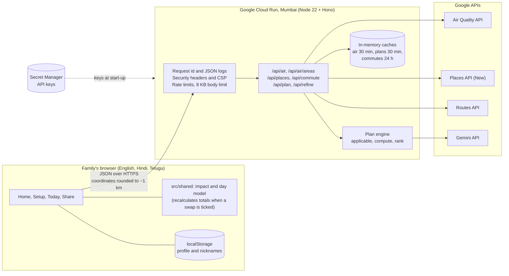
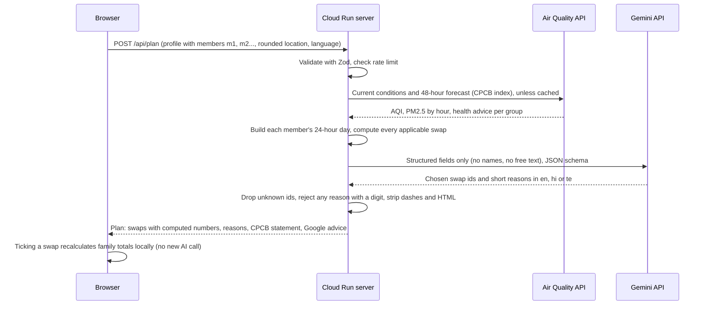
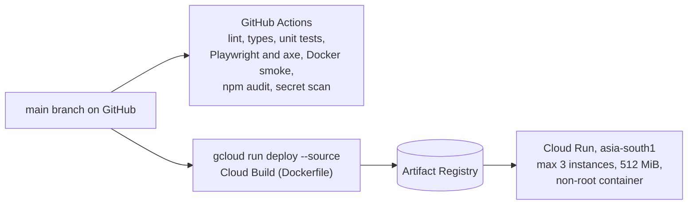

# SaafSaans architecture

SaafSaans is one TypeScript codebase: a small Hono server on Google Cloud Run that serves a
plain TypeScript front end and a JSON API. The rule behind every design choice is
**"Gemini decides, code computes"**: Gemini chooses and explains the changes that fit a family;
every number the user sees comes from tested code and published, cited factors.

Live: https://saafsaans-382086946715.asia-south1.run.app

## 1. System overview



## 2. How a plan is made



If Gemini is slow, unavailable or over its per-minute cap, a deterministic ranker returns the
same numbers with template text, so the app never depends on the model to work.

## 3. Where the numbers come from

| Step | Code | Source |
|---|---|---|
| AQI band and health statement | `src/shared/impact/aqi.ts` | CPCB National AQI |
| Indoor PM2.5 from outdoor air | `src/shared/impact/indoor.ts` | Single-room mass-balance model, published ranges |
| Breathing rates and daily dose | `src/shared/impact/dose.ts`, `src/shared/day/` | US EPA Exposure Factors Handbook |
| Cigarettes' worth | `src/shared/impact/dose.ts` | Berkeley Earth |
| Purifier size | `src/shared/impact/purifier.ts` | AHAM and US EPA |
| Transport CO2 | `src/shared/impact/transport.ts` | India GHG Program, Hyderabad Metro |
| Cleanest and dirtiest hours | `src/shared/impact/forecast.ts` | Live forecast; pattern from published studies |

Every constant lives in `src/shared/factors.ts` with the section of `docs/FACTORS.md` that cites
it. Values we chose inside a published range are labelled "Estimate" in the app.

## 4. Code map

```
src/shared/     used by server and browser
  factors.ts      every constant, with its source section
  actions.ts      the swap catalogue (lens, kind, category)
  plan-schema.ts  one Zod contract for the plan response
  impact/         aqi, indoor, dose, mask, purifier, transport, forecast
  day/            24-hour schedules, swap effects, family totals
src/server/
  app.ts          middleware order and static files
  routes/         air, places, commute, plan, refine, demo
  plan/           applicable, compute, rank
  gemini/         the only code that calls Gemini
  air.ts, places.ts, commute.ts   Google API clients (8-second timeouts)
  security.ts, cache.ts, config.ts, log.ts
src/client/
  home/           the guided home page
  app/            setup, today, share, router, local recalculation
  i18n/           en.json, hi.json, te.json
  styles/         dark black and green theme tokens
test/             unit, server, end-to-end (Playwright with axe)
```

## 5. Security and privacy layers

1. **Keys stay on the server:** read from Secret Manager on Cloud Run, sent to Google only in
   request headers, never logged or returned.
2. **Strict headers:** Content-Security-Policy with no inline scripts or styles, HSTS,
   nosniff, a strict referrer policy, and a permissions policy.
3. **Abuse limits:** 60 API requests a minute per IP, 10 a minute for plan and refine, a global
   cap on Gemini calls, an 8 KB body limit and 500 characters for refine text.
4. **Validated input:** Zod schemas at every route; coordinates limited to India and rounded to
   two decimals (about 1 km) before any call, cache key or log.
5. **Model output is untrusted:** schema check, known action ids only, no digits, no HTML, and
   no health advice from the model. Health text comes only from CPCB and Google.
6. **Privacy by design:** no accounts and no database; nicknames never leave the browser;
   logs carry a request id, route, status and duration only.

## 6. Build, test and deploy



## 7. How it was built

Spec first: `docs/SPEC.md` (what to build), `docs/FACTORS.md` (every figure and its source),
`docs/DESIGN.md` (look, motion and writing rules) and `AGENTS.md` (rules for the coding agent).
Development used Google Antigravity, working phase by phase: the calculations with hand-worked
reference tests first, then live Google data, Gemini, the screens, translations, and hardening.
Each phase was reviewed against the spec before the next one began.
